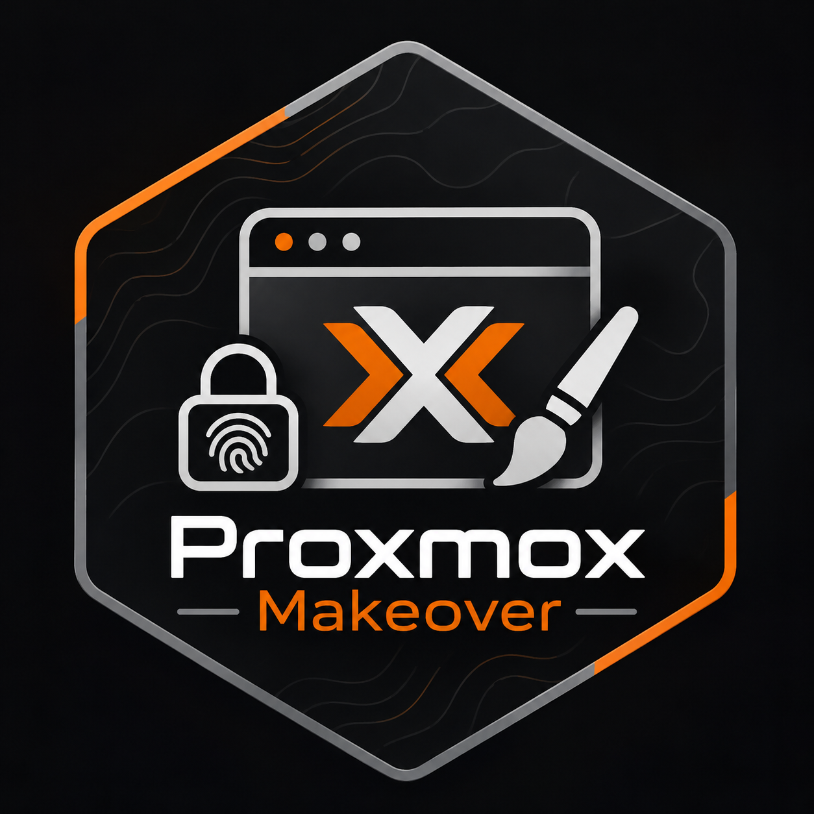
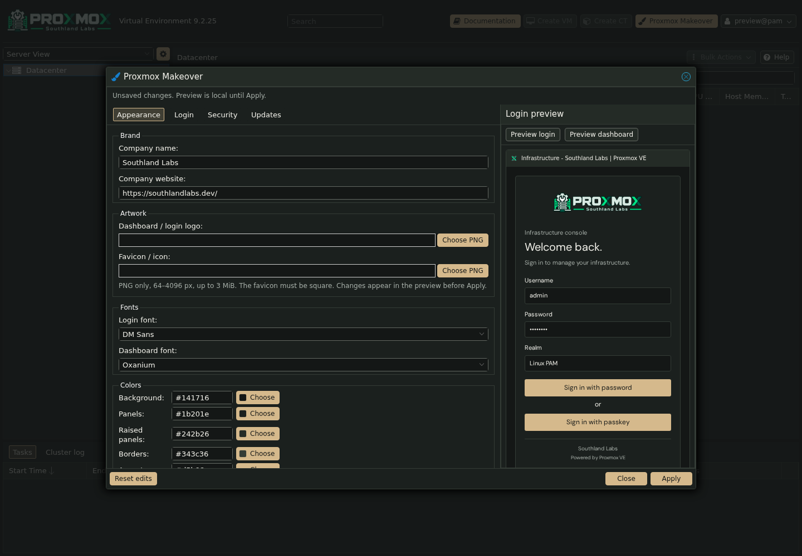

# Proxmox Makeover

<p align="center"></p>

A local appearance editor and optional passkey sign-in for Proxmox VE, by Southland Labs.

Change your logo, login text and colors from the Proxmox header. Preview the
login screen or dashboard before applying. Update protection is on by default
and can be turned off.



## Install

Run as **root over SSH** on a **Proxmox VE 9** node. Close Proxmox consoles and
wait for running tasks to finish first.

```sh
bash -o pipefail -c 'curl -fsSL --proto =https --proto-redir =https https://raw.githubusercontent.com/vipgabe09267/SLL_Proxmox_Makeover/v0.1-beta/bootstrap.sh | bash'
```

The installer downloads `v0.1-beta`, checks its SHA-256 checksum, installs missing
prerequisites from your configured APT repositories, and activates Makeover.
Activation briefly restarts `pvedaemon` and `pveproxy`. It refuses to interrupt
active Proxmox tasks or consoles. It does not reboot the host or guests.

Refresh Proxmox, then click **Proxmox Makeover** in the header.

For manual installation, extract the [release](https://github.com/vipgabe09267/SLL_Proxmox_Makeover/releases/tag/v0.1-beta)
and run `bash install.sh`. This stages a local copy and prints the activation
command. Use `bash install.sh --activate` to install and activate together.
The installer reports any missing prerequisites before activation.

## Uninstall

Run on the same node as root, with Proxmox tasks and consoles closed:

```sh
proxmox-makeover uninstall --activate
```

Uninstall uses the installed local files. It downloads nothing and retains your
configuration, backups and passkey records. It restores managed originals while
preserving later external edits. It briefly restarts the two Proxmox web services.
An installation adopted from the older Southland foundation restores that foundation.

## Customize

- Set your company name, HTTPS website, logo and favicon.
- Choose separate login and dashboard fonts: Default, System sans, DM Sans,
  Oxanium, Georgia or Monospace. Bundled fonts stay local.
- Drag the color wheel or enter exact hex colors.
- Edit login text and preview the login screen or dashboard.
- Show or hide the storage card in node Summary.
- Apply to save, or discard to return to the loaded settings.

PNG uploads stay on the node: up to 3 MiB each, 64–4096 pixels per dimension.
Viewing appearance settings requires `Sys.Audit`; changing them requires
`Sys.Modify` on `/`. Each account can manage its own passkeys.

## Passkeys

Password sign-in remains available. Local `pve` and `pam` accounts can add a
login passkey through the account menu → **Login passkeys**, or Makeover →
**Security**. Setup asks for your current password and device confirmation.
Signing in with that passkey does not ask for your username or password.

Configure native WebAuthn first: **Datacenter → Options → WebAuthn Settings**.
For `https://pve.example.com:8006`, use RP ID `pve.example.com` and origin
`https://pve.example.com:8006`. Use the hostname and port you actually visit.
Changing the RP ID or origin requires new enrollment.

The per-user **Use passkeys for 2FA** switch controls their role:

| Setting | Sign-in behavior |
| --- | --- |
| Off | A login passkey or normal login credentials. Other required verification still applies. |
| On | Password plus native extra verification. Passkey-only login is blocked. |

Changing the setting requires your current password, including for root.
Native two-factor keys and login passkeys are separate registrations; enroll
the required type once. Both lists have a **Remove** action. Switching the role
retains registrations and preserves other factors and required realm policy.

Login passkeys are **node-local**. Install and enroll separately on each node;
use this Makeover version or newer on every node offering its passkey login.
Changing/resetting a password, including a native password-hash upgrade,
invalidates existing login passkeys. Keep password/MFA recovery access.
See [passkey recovery](docs/PASSKEY-RECOVERY.md).

## Updates and recovery

Update protection reapplies your saved appearance to the current vendor files
after package changes. Turn it off in Makeover to apply changes manually.
It does not install Proxmox updates. Unsupported vendor changes are rejected;
future compatibility is not guaranteed.

```sh
proxmox-makeover status
proxmox-makeover apply
proxmox-makeover rollback --activate
```

Temporary native appearance: add `/?sls-branding=off&mobile=0` to your Proxmox
hostname. Native authentication remains required.

**Beta scope:** PVE 9, checked on `pve-manager` 9.2.25 and 9.2.26. PVE 8/10,
nonlocal primary-login realms and the separate native mobile app are outside
this release's validated scope.

[Security](SECURITY.md) · [Testing](docs/DEVELOPMENT.md) · [Release verification](docs/RELEASE-AUDIT.md)

## License

[GNU AGPL version 3 only](LICENSE) (`AGPL-3.0-only`). Supplied fonts retain their
[SIL Open Font Licenses](assets/fonts/). See [NOTICE](NOTICE) for dependency and
trademark notices. This community project is not affiliated with Proxmox.
